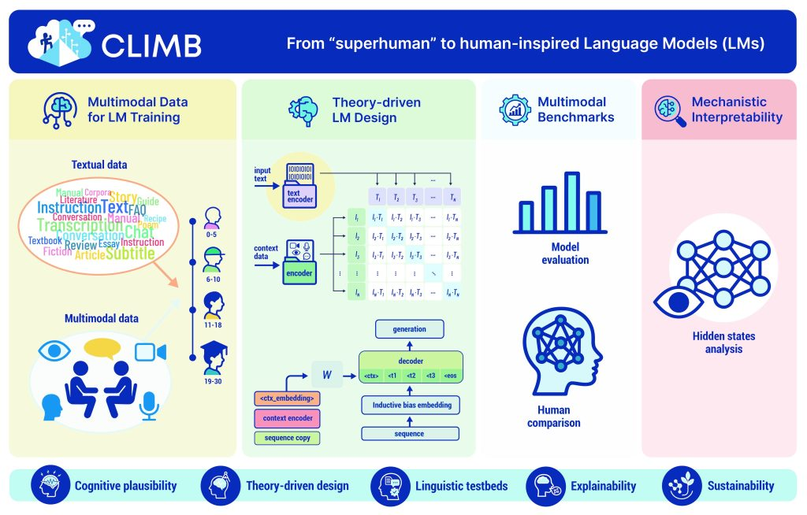
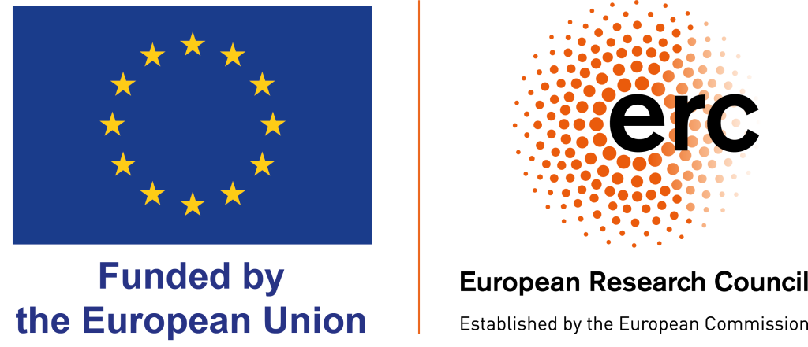

# CLIMB

**Cognitively-Inspired Language Models for Investigating Human Language Acquisition and Processing**

ERC Advanced Grant 2025 (ERC-AdG-2025, Grant No. 101266749)
Principal Investigator: [Alessandro Lenci](https://www.unipi.it/ateneo/organizzazione/persone/alessandro-lenci-5507/)
Host: [CoLing Lab](https://colinglab.fileli.unipi.it/), University of Pisa

## Overview

CLIMB draws on findings from linguistics, cognitive science, and developmental psychology to develop language models that are more cognitively grounded. The goal is to use these models to investigate the mechanisms underlying human language acquisition and processing.

## Project Website

https://colinglab.fileli.unipi.it/erc-climb/

## Publications

*To be added.*

## Contact

CoLing Lab, Department of Philology, Literature and Linguistics, University of Pisa
https://colinglab.fileli.unipi.it/contacts/

## Resources

- [CLIMB project page](https://colinglab.fileli.unipi.it/erc-climb/): official project website
- [CLEVER - Computational and Linguistic bEnchmarks for the study of VErb argument structuRe](https://github.com/Unipisa/CLEVER): project page on GitHub
- [BAMBI dataset](https://huggingface.co/datasets/colinglab/BAMBI_dataset): HuggingFace Dataset
- [CoLing Lab resources](https://colinglab.fileli.unipi.it/resources/): datasets and tools from the lab

## Team

See the [CoLing Lab people page](https://colinglab.fileli.unipi.it/people/).

## Funding

Funded by the European Research Council (ERC) under the European Union's Horizon Europe research and innovation programme (ERC Advanced Grant, Grant Agreement No. 101266749).

Views and opinions expressed are those of the authors only and do not necessarily reflect those of the European Union or the ERC
